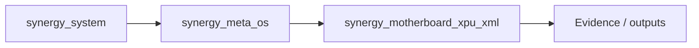
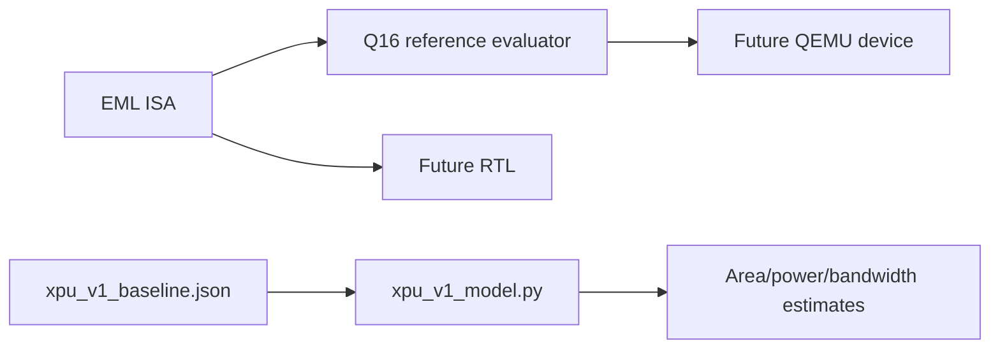

# SHTENCO Motherboard XPU / EML

Research and engineering repository for a **persistent programmable dataflow XPU** built around EML computational primitives.

The long-term hypothesis is that workloads traditionally split across **CPU, GPU, RAM and SSD** can be mapped onto one capability-addressed fabric with three state classes:

- **Value State** — active scalar/vector/tensor values;
- **Graph State** — executable EML/dataflow graphs;
- **Persistent State** — content-addressed programs, models, files and snapshots.

The repository deliberately separates **measured software facts**, **parameterized architecture models**, **FPGA targets**, and **future ASIC hypotheses**.

## XPU V1 baseline

The first quantitative baseline models a 2.5D package with:

- 4 compute chiplets;
- 8,192 total EML lanes;
- 1.2 GHz target lane clock;
- 72% modeled sustained utilization;
- 4 HBM3E stacks;
- central I/O/control die;
- persistent-state tier;
- PCIe/CXL host interface;
- capability/IOMMU constrained DMA model inherited from the TURBO XPU work.

At these assumptions the analytical ceiling is **7.077888 T EML primitives/s**. This is **not FLOPS** and must not be compared directly with GPU TFLOPS/TOPS until an EML-to-workload equivalence metric is defined.

With 4 x 1,180 GB/s HBM3E stacks, raw package bandwidth is **4.72 TB/s**, giving a compute-memory balance of about **1.50 EML-op/byte**. By contrast, PCIe 5.0 x16 (~63.02 GB/s per direction after encoding overhead) requires about **112.3 EML-op/byte** to keep the same compute fabric occupied. That gap is the quantitative reason the architecture emphasizes resident/persistent state and near-data execution.

## Repository layout

```text
config/                 machine-readable baseline assumptions
spec/                   architecture + EML ISA/dataflow contracts
calculations/           reproducible area/power/bandwidth models
hardware/3d/            package models (OpenSCAD + STL)
hardware/rtl/           RTL/FPGA implementation plan
software/               compiler/runtime/QEMU integration plan
```

## Current claim boundary

Implemented here now:

- reproducible analytical model;
- explicit assumptions and sensitivity equations;
- EML-XPU ISA/dataflow draft;
- 2.5D package floorplan;
- parametric OpenSCAD 3D model;
- ready-to-open ASCII STL package model;
- FPGA/QEMU/RTL work breakdown.

Not claimed yet:

- fabricated EML cell;
- timing-closed RTL;
- validated cell area/energy from synthesis;
- physical HBM/CXL controller;
- SSD-class persistent medium integrated in silicon;
- GPU/CPU replacement benchmark equivalence.

## Immediate roadmap

1. Freeze EML numeric semantics and bit-exact reference evaluator.
2. Implement one synthesizable EML lane and measure area/Fmax/pJ per primitive on FPGA/ASIC libraries.
3. Build tiled scheduler + NoC + local SRAM model.
4. Extend the existing four-sector XPU transport into a QEMU MMIO/DMA device.
5. Run kernels through software reference == QEMU == FPGA equivalence tests.
6. Replace modeled area/power coefficients with synthesis/measurement evidence.

See `calculations/XPU_V1_BASELINE.md` and `hardware/3d/xpu_package.scad` first.


<!-- SYNERGY-FEDERATION-PASSPORT:START -->
---

##  SYNERGY federation passport

**Домен:**  XPU / hardware description  
**Архитектурный родитель:** [`synergy_meta_os`](https://github.com/Shtenco/synergy_meta_os)  
**Архитектурный корень:** [`synergy_system`](https://github.com/Shtenco/synergy_system)



### Документационный контракт

README должен показывать: проблему → архитектуру → реальные артефакты → проверку → ограничения → связи с федерацией. Сильные claims без evidence остаются R&D/CANDIDATE.

### Навигация

- [ Атлас всех 75 репозиториев](https://github.com/Shtenco/synergy_system/blob/main/docs/SYNERGY_REPOSITORY_ATLAS.md)
- [ Машиночитаемый registry](https://github.com/Shtenco/synergy_system/blob/main/registry/SYNERGY_REPOSITORIES.json)
- [ SYNERGY SYSTEM](https://github.com/Shtenco/synergy_system)

### Authority rule

Репозиторий не присваивает полномочия соседнего домена: AI ≠ authorization, UI ≠ ledger, blockchain commitment ≠ accounting truth, backtest ≠ realized external P&L.

<!-- SYNERGY-FEDERATION-PASSPORT:END -->

---

#  Глубокий доказательный паспорт XPU

## Что уже materialized

`main` содержит machine-readable baseline, analytical model, EML Q16 reference evaluator, ISA/architecture specs, OpenSCAD package model и CI model workflow.



## Claim boundary

`7.077888 T EML primitives/s` — analytical ceiling из заданных параметров, не measured silicon throughput и не FLOPS/TOPS equivalent.

## Следующий рубеж

bit-exact semantics freeze → synthesizable lane → FPGA synthesis/Fmax/power → reference=RTL equivalence → measured coefficients replace modeled assumptions.
